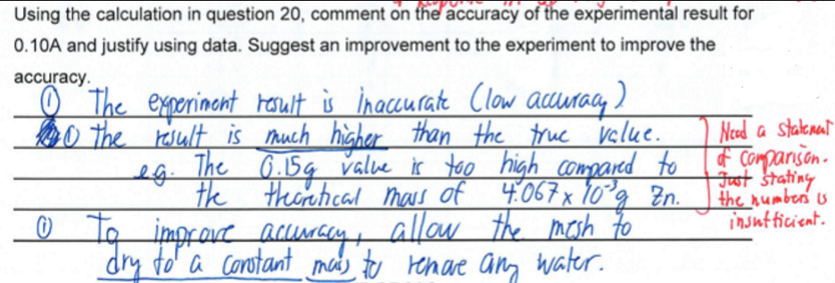
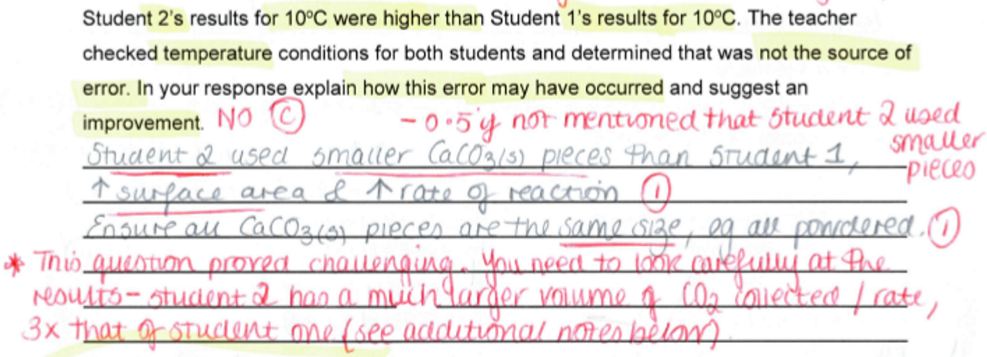
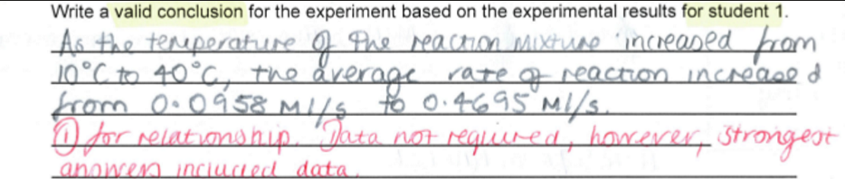

---
---
See the bio notes for much more in depth notes
The below is what to memorise for the chem sac

**Title** of graph:
	- The relationship between IV and DV after __ minutes

Example aim from vcaa
**Aim**: To find the effect of varying the current on the mass of copper deposited during electrolysis. 
2 mark aim:
	1- Clear aim including IV and DV
	2- How the aim is achieved
		a. changing current and measuring the change in mass of the cathode.

Is there a trend in the **graph**? (if there is one outlier) (one mark)
· Yes. If the data was presented using a line of best fit the overall trend is consistent with the prediction.
It is important that students recognise the presence of anomalous data and avoid generalisations when specific information is shown/given.

State a suitable **hypothesis** for this experiment. (2 marks)
As the charge supplied to the cel increases then then mass deposited at the cathode
increases.

Safe **random errors** to say
• uncertainty in measurement of the [water] height
• minor fluctuations in temperature during the 10-minute reaction time
• uncertainty in measurement of solution volumes
• minor variations in the stop/start of the timer
• The cathode has not been dried to constant mass, so the experimental mass is higher
than the theoretical.
• Varying SA

**Improvements**
Any one of:
• collect the O2 gas produced in a gas syringe/ inverted measuring cylinder
• Conduct trials at temperatures close to either side of the suggested optimum
temperature to obtain a more definitive peak on the graph.

Write a valid **conclusion** for the experiment based on the experimental results. (if 1 mark)
As the temperature increases the concertation of methanol at equilibrium decreases.
Write a suitable conclusion for the results given in the table above (2 marks)
In this experiment, the mass of copper deposited during electrolysis increased as the current increased. This was a linear relationship/mass of copper is directly proportional to current. 

**Hazards**

|                  |                         |                                                                        |
| ---------------- | ----------------------- | ---------------------------------------------------------------------- |
| Boiling water    | Burns                   | Take care when handling, use appropriate glassware + heat proof gloves |
| Broken glassware | Take care to avoid cuts | Wear lab coat and safety glasses                                       |

What does a student need to do to ensure that they comply with all applicable safety guidelines?
Refer to an approved risk assessment document
Follow storage, handling and protective equipment guidelines in the material safety data sheets.

Tube F is a **control** (1m) and provides a baseline for comparison of the effects of each
change in each trial (1m) (and thus what effect)
(not just 'determine whether the changes are actually due to the IV')

A manufacturer of methanol had chosen to use a temperature of 520K for this reaction even
though the equilibrium concentration of methanol is greater at lower temperatures. Explain
why this temperature was chosen.
1- A lower temperature means a lower rate of reaction, but a higher yield of
methanol.
1- A compromise of 520K means a moderate yield with a higher rate of reaction.

## Discussion

 
Repeatability (entire experiment)
	· Closeness of experimental data
	· Same conditions, same operator, etc.
	· The experiment is repeatable as the experiment was repeated under the same conditions eg ___ and the results are close to one another eg ___

 
Reproducible (entire experiment)
	· Closeness of experimental data
	· Changed conditions e.g., different operator
	· The experiment is reproducible because the experiment was repeated under different conditions (eg different operator) and the results are close to one another eg __

How does collating class results for this experiment help evaluate the strength of the experimental design?
Collating class results means the reproducibility of the experiment can be evaluated (1m)
and it can be judged whether the method produces the same results when others repeat the experiment using different equipment (1m)
*You can't answer "increased precision" for this!

Accuracy
	· How close the experimental value is to the true value
	· The results are accurate because the experimental result of (add data here) is close to the true value of (add data here)
	· Accuracy cannot be commented upon as the true value is unknown.

Validity (entire experiment)
	· The experiment measures what it claims to measure (only IV is changing)
	· The experiment is valid because only the IV (IV with units) is changing, all other variables, e.g., (controlled variables) are controlled.
	• *So the change in froth height/enzyme activity can therefore be attributed to the change in temperature.*

Precision
	· How close repeated results are to each other
	· The results are precise because the repeat values of (add data here) are close to each other. 
	• *The experiment was not repeated so precision cannot be commented on.*
	General rule: For results to be 'precise', repeat values must be within 1% of each other and there must be three.
	
	
Random Errors
	· Small fluctuations in an experiment
	· Can only be minimised by repeating, improves precision
 
Systematic Errors
	· Constant bias in measurements 
	· Minimised by changing the design of the experiment, improves accuracy
