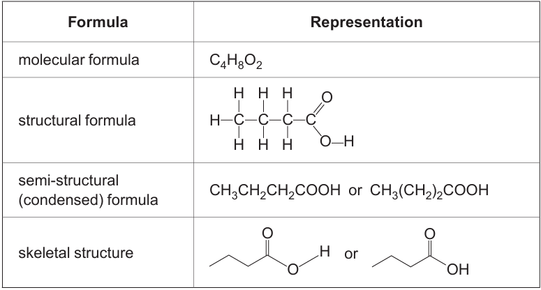

---
---
Electron dot diagram
- use dots or crosses to show shared e- (bonds)
- see wb pg 132
- there is a specific order you must place the electrons (check wb)

Valence diagrams (lewis structures)
- lines show bonds (1 line = 1 shared pair)
- show lone electrons as dots

Structural formula
- same as valence diagrams except lone electrons aren't shown

Skeletal formula
- 1 line represents C-C bond. (a vertice is a carbon)
- double line represents C=C
- don't write carbon or hydrogens, but write the functional groups (including its hydrogens)
- there is no carbon on a vertice that has another element (eg oxygen)
- need to write H if the H is not bonded to a C

___
Molecular formula ($C_4H_{10}$) (more common)
- Shows total # of atoms of each element within a compund

Empirical formula ($C_2H_5$)
- the simplest whole number ratio of elements within a compound

Semi structural formula ($CH_3CH_2CH_2CH_3$)
- shows order, and formula of functional groups
- can have OH at the start, it doesn't matter. But then you must write HO
- If you write -CHO then it's an aldehyde (not an alcohol)
- if it is a branch you have to put it in a () with no number

Data book item 18
