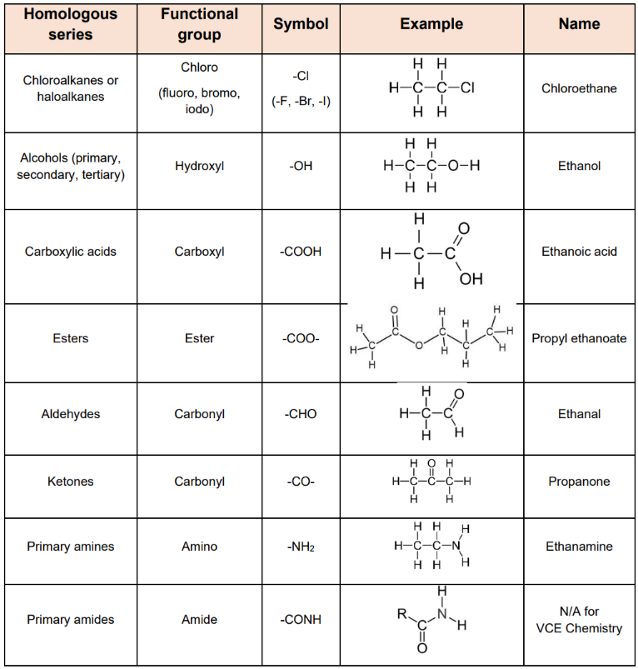

---
---

Naming summary
1. Identify the longest chain that has the main functional group
	-> prefix = # carbons, suffix = functional group 
	write but-1-ene (instead of 1-butene) (1-butene is the old way of saying it)
2. Side chains numbered based on lowest carbon
	 dash between number and word
	 multiple of same side chain - number, number-di___
3. multiple numbers - must be numerical order, separated by commas
	 side chains are alphabetical order, the di/tri/tetra are excluded when alphabetical ordering

Carbon chains
1. meth
2. eth
3. prop
4. but
5. pent
6. hex
7. hept
8. oct
9. non
10. dec

Priority is also in the data book

Rings
Add the prefix "cyclo-" to the number of carbons (eg if it is 6 carbons in a ring it is cyclohexane)
Benzene - 6 carbons bonded in a ring. each carbon is bonded to 2 carbons and a hydrogen, therefore delocalised electrons are found above and below the ring (actual question will be asked).
note benzene is C6H6, cyclohexane is c6H12
* methylcyclobutane is the hardest cyclo you will need to name

Compounds with benzene are called aromatic compounds

Things to note
- 1-hyroxybutan-3-one is wrong, It's 4-hydroxybutan-2-one, because you are prioritising the ketone even if it's not at the end
- you won't get a situation where a branch has a branch