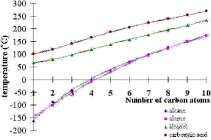

---
---

|                                  |                                                                                                                                                                                                                                                                                                                                                                                                                                                                                                                                                                                                                                                                                                                                                                                      |
| -------------------------------- | ------------------------------------------------------------------------------------------------------------------------------------------------------------------------------------------------------------------------------------------------------------------------------------------------------------------------------------------------------------------------------------------------------------------------------------------------------------------------------------------------------------------------------------------------------------------------------------------------------------------------------------------------------------------------------------------------------------------------------------------------------------------------------------ |
| Solubility                       | Miscible - liquids that m__ or are soluble in each other Immiscible - liquids that do not mix nor soluble and have different d__  eg hexane + water - hexane forms layer on top because less dense, and cannot dissolve  Soluble in water if it is polar or can form hydrogen bonds  solubility affected by polarity of functional groups and the length of the nonpolar hydrocarbon tails.  smaller members of the aldehyde, ketone, ester, alcohol, amine and amide homologous eseries are generally soluble in water. Their solubility in nonpolar organic solvents increases as their chain length increases  Solubility decreases as the chain length increases.  Alkanes, alkenes, alkynes are soluble in nonpolar organic solvents  |
| Boiling point                    | Increases as molecules get larger (true for all homologous series) if an alkane and alkene have same number of carbons they will have a similar boiling temp, except alkanes slightly lower                                                                                                                                                                                                                                                                                                                                                                                                                                                                                                                                                                                    |
| Density                          |                                                                                                                                                                                                                                                                                                                                                                                                                                                                                                                                                                                                                                                                                                                                                                                      |
| Viscosity                        | More viscosity = higher Number and strength of intermolecular attractions  Eg motor engine oils - high viscosity - reduces friction and wear - as temp ^, ciscosity of the engine v due to disruption of the intermolecular forces  smaller molecules have lower viscosity  The higher the viscosity of the linger-chain hydrocarbons is due to the tendency of longer molecules to become 'tangled' together                                                                                                                                                                                                                                                                                                                                          |
| Flashpoint (not in study design) | Organic chemicals can be classified as flammable or combustible according to their flashpoints  lowest temperature at which the liquid gives off enough vapour to start burning at its surface on the application of an ignition source. In these cases it is not actually the liquid tha tburns in the oxygen in the air. Below flashpoint there is not enough v__ available to support combustion.  Flammable - flashpoint below 37.8*C (else combustible)                                                                                                                                                                                                                                                                                                    |
| Volatility                       | Volatile if it easily changes from one state to another Or tendency to evaporate  Compounds with smaller molecules are more volatile  the stronger the dispersion forces between molecules in the liquid state, the less likely the liquid will evaporate.                                                                                                                                                                                                                                                                                                                                                                                                                                                                                                         |
less energy is needed to break intermolecular attractions of smaller molecules
Bonding within hydrocarbons is covalent (strong)
Hydrocarbons are non-polar
The forces between molecules are dispersion forces (weak) but increase in strength as the molecule gets bigger so boiling point increases

As go up from primary-secondary-tertiary isomers, the bp gets lower as weaker attractions as more 'branched' (less SA and less ability to pack tightly)

Carboxylic acids are weak acids
A dimer is both molecules

Solubility in water decreases with chain length
Boiling points increase with chain length
___
Aldehydes and ketones
Smaller aldehydes smell worse
Can form h bonds with water, but solubility decreases with increased length of the nonpolar chain
BP is between alkanes and carb acids because can do dipole but not H bonds with each other

Esters
Anything that gives a fruity smell
Volatile (this is how you smell them)
Shorter chains can be soluble in water

### States

methane to butane exist as gases at room temperature
Pentane and above are liquids at room 20*C

Alcohols - all liquids are at room temp, has H bonding

Amines - first 2 members are gases then liquids
Amide - methanamine is a liquid at room temperature then larger amides are solids
Carboxylic acids - all are liquid at room temp due to hydrogen bonding
Aldehydes - Methanal is a gas at room temp. Ethanal boils at 21*C
Ketones - all are liquids from propanone
Esters - all are liquids
Boiling points are generally alkenes\<alkane

Pentane and higher - assume liquid

**The general response for BP (checklist):**
Energy required to break IMF
Increase/decrease
	• Length of carbon chain + # of carbons in the chain
		○ Number of dispersion forces (more e-)
		○ (and effect of the polar FG)
	• Molar mass (eg for haloalkane effect)
	• More linear/branched structure
	• Ability to pack closely together (branching)
	• {Accessibility for} polar FG's to form H bonds with water
	• # of {sites that} H bonds that can form (comparing hydroxyl and carboxyl)
	• Strength of the __ force
	• Overall IMF strength
	• Dipole/H bonds between __ and __ (on separate molecules)
	• Viscosity – molecules held together strongly – higher resistance to flow