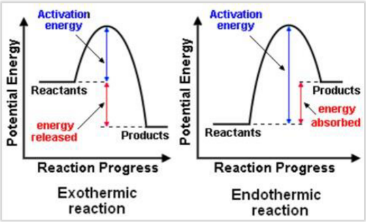

---
---
Rate - speed of reaction
 yield - output

### factors affecting freq + success of reactant collisions
- Energy of particles > Ea (to overcome repulsion)
- collision frequency
- particle orientation at collision

### Catalyst
substance which ^ ROR by providing an alternative pathway of v Ea.
 Catalysts remain unchanged and can be used again

reaction occurs on the catalyst surface. the larger the surface, the more 'effective' the catalyst
### Effect on ROR

|                |                                                                                                                  |
| -------------- | ---------------------------------------------------------------------------------------------------------------- |
| [ ]^           | ^ # particles in given vol ^ freq of successful collisions                                                    |
| SA ^           | ^ # particles available at surface [of thing] to interact ^ freq of successful collisions                     |
| Temp^          | ^ avg particle KE ^ freq of successful collisions  ^ % particles w/ min Ea ^ % successful collisions |
| Catalyst added | Alternative pathway of v Ea provided ^ % particles w/ min Ea ^ % successful collisions                     |
| Amount/volume  | N/E                                                                                                              |

... ^ ROR.

Be specific to the reactants given (state them)
Also apply to question eg breaking the tablets ^ SA

### Energy profile diagrams

write the actual names of the reactants and products

Exothermic = spontaneous
Endothermic = non spontaneous