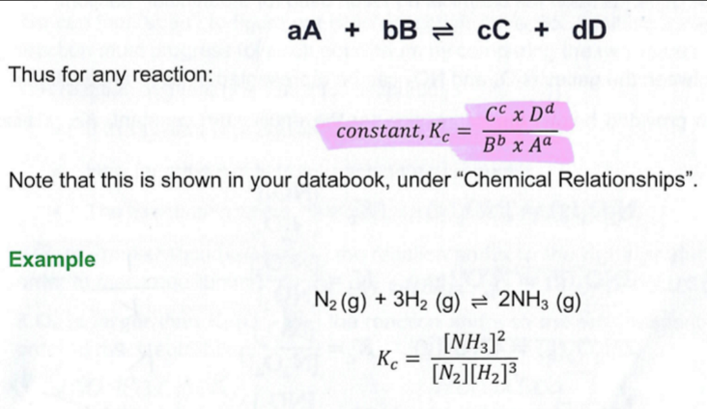
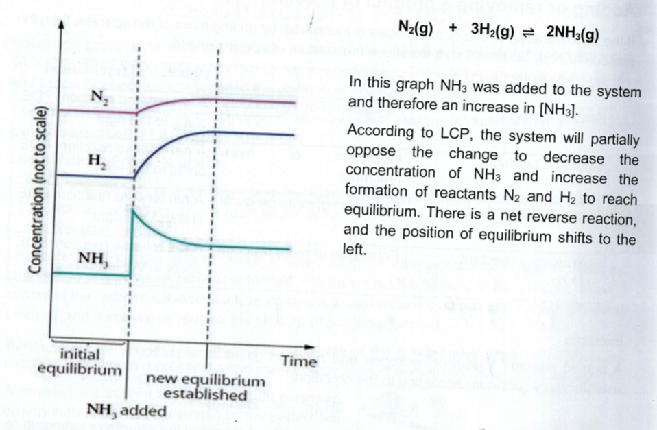

---
---

"In an open system, matter and enegy can be exchanged with the surroundings. In contrast, a closed system only exchanges energy with the surroundings."

$\leftrightharpoons$ reactions can reach equilibrium

Equilibrium - when the reaction and reverse reaction are occuring at the same rate
extent - how far the reaction proceeds.
high extent - more product compared to reactant

POE
 - where the overall conc of reactants and projects do not change over time
- At the position of equilibrium, the forward and reverse reaction rate is equal.
- It is **dynamic** state - forward and reverse haven't stopped, just equal rate
- not necessarily equal []'s of the reactants and products

Dynamic
2 mark response:
- when the rate of the forward and reverse reactions are equal (1)
- the concentrations of the reactants and products remain constant (1)

___
### Rate graph
At the start, the reaction happens but no reverse reaction. It slows until reach equilibrium. THe forward and reverse reach equilibrium (plateau in rate) at the same time

### Concentration-time graph
if a reactant uses 2 mol in the equation, the change in concentration before equilibrium is double
(will be expected to draw)

**The graph only shows one line for H2 and I2. Why?**
There is no H2 and I2 at the beginning of the experiment due to the 1:1 ratio, they ^ by the same amount. Therefore, [H2] and [I2] are equilibrium are the same
## Equilibrium law
**Equilibrium constant (K) (concentration fraction)**
- The **extent** of a chemical reaction proceeding towards the products or reactants
- the ratio of products to reactants at equilibrium.
- K will only change when the temperature changes.

- when calculating, ignore H2O(l) and solids

**Homogeneous vs heterogeneous Equilibria**
homogeneous - has everything in the same state.
Heterogeneous:
- \> 1 state present
- if this happens then you exclude the solids and liquids from the conc fraction

K < 10$^{-4}$ - favours backward reaction
 K > 10$^4$ - favours forward reaction
 
Q = reaction quotient
 at equilibrium, Q = K

Q - quantitative measure of the extent of a chemical reaction: the relative amounts of products and reactants present during a reaction at a given point in time

**Example question**
The equilibrium constant, K, for the formation of $NH_3$ is 2.7\*10$^8$ M$^{-1}$ @ 300K.
$$N_2(g) + 3H_2(g) \ce{<=>} 2NH_3(g)$$ where Delta H = -46kJ/mol

a. At a particular time, the []'s of each species is 1.7M. Has equilibrium been reached? Ise calculations in your answer.

$Q = \frac{[NH_3]^2}{[N_2][H_2]^3} = 0.35M^{-2}$
*Equilibrium has not been reached, as Q < K, 0.35 < 2.7x10$^8$ (actually say <, not just !=)*

b. Is a net forward or backwards reaction required to reach equilibrium? Explain.
*$[NH_3]\uparrow and [N_2]\downarrow , [H_2]\downarrow$ so $Q \uparrow$ until it is $= K.$
___
K value calculations not in equilibrium - use RICE
- 'initial mole or concentration'
- 'The system is allowed to reach equilibrium'
- 'The initial mole was this… when the system has reached equilibrium the amount was…'

In rice tables
- use mol, not concentration
- reaction, initial, change, equilibrium

### LCP
If a system is at equilibrium and the temperature, pressure or concentrations of the species are changed, the reaction will proceed in such a direction as to partially oppose this change

LCP states the change is only partially opposed; the system does not return to original equilibrium position

in equilibrium reactions there's always a bit of everything present, so limiting reactants aren't relevant

|                                                        |                                                                                                                                                                  |
| ------------------------------------------------------ | ---------------------------------------------------------------------------------------------------------------------------------------------------------------- |
| Adding a reactant                                   | Formation of more products  POE favours forward reaction                                                                                                   |
| Removing a reactant                                 | Formation of more reactant  POE favours reverse reaction                                                                                                      |
| ^ Pressure                                          | Favours side with fewer mole  ^P also quite dangerous (vessels must withstand high temperature, if hydrogen can talk about flammability, ignition sources) |
| Concentration (water) (increase volume (dilution))  | Favour side with greater mole                                                                                                                                    |
| Temperature                                         | Favour endo/exo to counter the change in temp conditions                                                                                                         |
| Catalyst                                            | Does not affect K.  Increase rate of forward and backwards equally  Reach equilibrium quicker                                                              |
| Addition of inert gas                               | Total pressure ^ without changes in pressures of the reactants and products  No change to K                                                                   |
| Addition of inert gas in non fixed volume              | - V ^  - PP of every gas v.  - POE will shift to ^ P, side of more mol. shift right.                                                                       |

How to answer question

|     |                                                                    |                                                                                                                                                                 |
| --- | ------------------------------------------------------------------ | --------------------------------------------------------------------------------------------------------------------------------------------------------------- |
| 1   | indicate the change                                                | Addition of $N_2$                                                                                                                                               |
| 2   | Explain the effect of the change                                   | $[N_2]\uparrow$                                                                                                                                                 |
| 3   | Indicate the side favoured and why and the direction of the shift. | LCP states the Position of equilibrium will shift to partially opposite this change to $\downarrow[N_2]$ Position of equilibrium  favours the forward reaction3 |
| 4   | If necessary, explain the effect on products and/or reactants.     | $[NH_3]\uparrow, [H_2]\downarrow,[N_2]\downarrow$ but still Higher than orighinal. K is unchange.                                                               |

- the change in y value must be proportionate compared to each line in relation to the mols in the equation
- the starting concentrations doesn't matter because it's not known

Example questions

|                                                                       |                                                                                                                                                                                                                                                                        |
| --------------------------------------------------------------------- | ---------------------------------------------------------------------------------------------------------------------------------------------------------------------------------------------------------------------------------------------------------------------- |
| V Temp                                                             | If v T, LCP states POE will shift to partially oppose this change by ^T.  POE shifts to favour the exothermic reaction, the forwards reaction.  [NH_3]^, [N_2]v, [H_2]v. K^; more product is formed                                                           |
| Add reactant                                                       | Add reactant  - [reactant]^  - LCP states POE will shift to partially oppose this change in order to v[reactant].  - POE shifts to the right                                                                                                               |
| Remove reactant                                                    | Remove reactant  - [reactant]v  - LCP states the POE will shift to partially oppose this change in order to ^[reactant[  - POE shifts left / favours the backward reaction  - [products]v, [reactants], but still v than original  (K is unchanged)  |
| Why does the fwd reaction v as equilibrium is approached           | Lower conc, less reactants available to create reaction                                                                                                                                                                                                             |
| Why does the reverse reaction rate ^ as equilibrium is approached  | Higher concentration                                                                                                                                                                                                                                                |

### How to have fast ROR while producing the most product

How do catalysts contribute to addressing the conflict between reaction rates and temperature in chemical processes?
- Catalysts ^ROR by providing an alternative pathway of v Ea. Therefore High temperatures are not required.

How can the principles of green chemistry be applied to minimise the environmental impact of chemical manufacturing while maximising efficiency?
- Atom economy -> reaction is optimised by incorporating all reactant atoms into the desired product, this maximises efficieency (also less waste). Specificise into question asked
- catalysts
	- Don't need high temperatures (which need to burn fossil fuels)
	- Reducing energy consumptoin and minimising unwanted side reations
- optimise the process with separation methods + efficient nrg usage
- explore innovative reactor designs and alternative energy sources
- incorporate a process to continuously remove products, shifting the equilibrium towards the desired products. Allows for lower temperatures while maintaining high yields
- assess the environmental impact

Discuss the strategies for resolving the conflict betewen optimal reaction rates and temperature considerations in the production fo equilibrium reaction products. With a focus on the green chemistry principles of catalysis and designing for energy efficiency, provide two distinct approaches, one for each principle.
*Catalysis* - have the reaction use a catalyst, which lowers the activation energy required by providing an alternate pathway. Thus using less energy (lower temp required) to produce more products
*Design for energy efficiency* - minimize energy required to produce products by designing machinery to prevent energy loss and use eco friendly sources of power, ^ rate while reducing environmental impact

