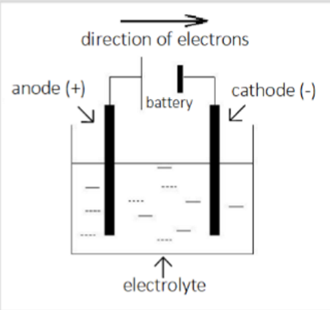
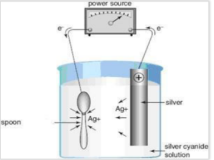

---
---
Electrolysis - splitting of compounds using electricity
 - process in chich an electric current is passed through an electrolyte to force a non spontaneous reaction.
 - reverse of the normal galvanic cell reaction

electrical -> chemical, endothermic
### Electrolytic cells

AN OIL RIG CAT still applies.

Anode - the side releasing the electrons (for both electrolytic and galvanic)
Negative charge side - the side you want to load the electrons
 
Electrochemical series:
 - opposite of galvanic cells. Electrolytic cells favour the  "shortest Z" (whereas galvanic is tallest S)
 
products of electrolusis must be kept separate because they could spontaneously react.
 
molten- put everything as liquid (not aq)
 aqueous - account for water
 
Exception (cl and h20 in the electrochemical series)
 <= 1M of Cl = H2O reacts
 (1, 2) M of the CL - both are reacting
\>= 2M = Cl reacts

voltage is always negative (non spontaneous)

The cathode does not participate in redox
- Even if it is the strongest to be oxidised
- As metals can only react by oxidising and the cathode is constantly supplied with electrons it does not lose electrons (cathodic protection) So an iron cathode acts like an inert electrode
- Although the cathode material doesn't react, reactions can happen at surface of electrode

Why does changing the cathode not affect the half or overall equations in an electrolytic cell?
- During electrolysis cathode (-) is the site of reduction
- Therefore, as e- are pumped onto the cathode from the anode, Metal X is unable to oxidise.
- Therefore overall equation unaffected.

A bit is required to overcome the internal resistance in the wire

"calculate the minimum EMF that should be applied to this cell"
- it's just the same as galvanic except you put a negative (and add 0.1V for overpotential)

### Secondary cells
- rechargable cells
- galvanic and electrolytic cell combined

when flat, the cell is connected to a power supply with a higher voltage and the reactions are reversed
- anode degrades so in recharging it needs to become a cathode

in galvanic cells, it is negative because the source is negative. whereas in electrolytic cell it is actually negative

requirements for a secondary cell
- reactions must be reversible
- products (state the ones that actually need to) must remain in contact with the electrodes
- connected to a power supply
- therefore the cell can be recharged

### Electroplating
deposition of a metal on the surface of another metal via electrolysis

why
- to enhance appearance of an article
- To protect corrosion prone materials such as iron from rusting

Anode (and ions in electrolyte) is coated onto cathode
Cathode must be a conductor. If not (eg a leaf), must be coated with metallic paint first

The Ag+ concentation in the solution should remain constant as, as it is used more Ag+ is put from the anode

**Battery life**
- performance of the battery
High temperatures decrease battery life. This is because rate increases and products can break away from electrodes, decreasing the available reactants/ products for discharge/ recharge. This decreases the number of discharge/ recharge cycles.

During discharge, lithium carbonate, Li2CO3, deposits break away from the electrode. Describe how this might affect the performance of the battery.
Li2CO3 deposits break away means less Li2CO3 in  contact with the electrodes. Less Li2CO3 available for recharge
Performance drops, battery life V

**Electrorefining of ores** (eg getting Al from Al2O3)
- used for metals of group 1 and 2
- molten (l) version of the ores as the electrolyte
- other compounds are added to the ores to reduce their melting temperatures (ionic compounds have very high MP's)

**Electrorefining of copper**
- impure copper is coated onto pure copper
- at the anode the strongest reductants are oxidised.

1. Oxidise the anode until copper and all stronger reductants are oxidised
		weaker ones won't oxidise unless copper has finished oxidising, so it is stopped before copper is done (the solid particles simply fall out as anode mud once loose)
2. At this point copper is the strongest ion to be reduced, so can reduce
