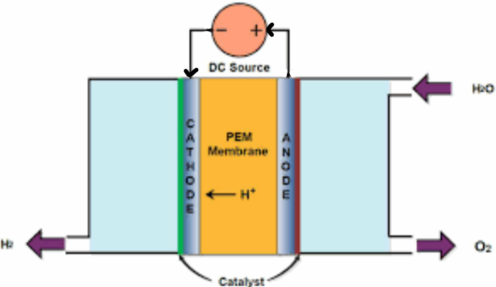

---
---

Using H2 as a fuel is usually obtained by reforming CH4.
- which is a natural gas (non renewable)
* green hydrogen is produced from H2O and so is more renewable and more sustainable

both types are **acidic conditions** unless otherwise stated

**Polymer electrolyte membrane (PEM)** (~~or is it proton exchange membrane?~~ wb pg108)
- electrolysis of water
- units are relatively small and portable
- but uses solar or wind energy to drive this (instead of burning coal)
	- solar/wind -> electrical -> chemical
- Anode: $2H_2O(l) \rightarrow 4H^+(aq) +O_2(g) +4e^-$
- Cathode: $2H^+(aq)+2e^- \rightarrow H_2(g)$
- more renewable and more sustainable as it is produced from H2O(l) rather than from natural gas.

**artificial photosynthesis (mimicks LD stage)**
- solar -> elec -> chem
- Anode: $2H_2O(l)\rightarrow 4H^+(aq) + O_2(g)+4e^-$ splitting of water
- Cathode: $2H^+(aq) + 2e^- \rightarrow H_2(g)$

H2 and O2 (products) must be kept separate to avoid the direct spontaneous reaction

the e- produced at anode = e- produced at cathode
H+ produced at anode = H+ used at cathode
therefore no charge build up
'Why is it more sustainable to produce hydrogen these ways