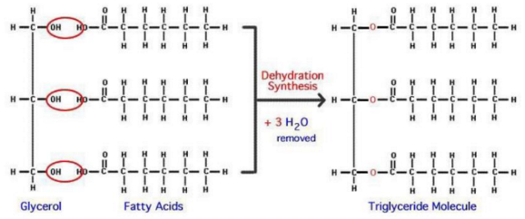
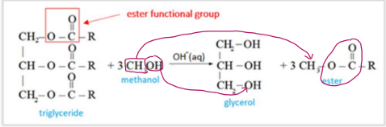
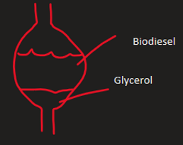

---
---

## Carbs

Condensation  / hydrolysis
	- Forms glycosidic bond (don't need to know what happens to the structure, know what it is is enough. But it's the H on the left glucose and the OH on the right (carbon 1 and carbon 4). Carbon 1 can form a bond with 6 as well to form a branch, see dB)
		○ (aka ether bond)
		○ When circling the bond, you circle the O and exactly half of the bonds coming out of it

Numbering the carbons
	- The one outside the ring is always #6. #1 carbon always directly right of the O

When drawing in skeletal formula, you just copy the data book except you don't draw the -H's, and replace CH2's with lines

When writing equations to form disaccharides, you have to draw it twice, don't do x2.

Monosaccharides
	- Glucose
	- Galactose (lactose) (converted to glucose)
	- Fructose (fruits, honey) (converted to glucose/glycogen)
	- They are all isomers of each other

Disaccharides
	- Maltose (starch) (glucose + glucose) (the one we need to focus on)
	- Lactose (milk) (glucose + galactose)
	- Sucrose (juice) (glucose + fructose) (don't need to know)

Polysaccharides (fully glucose)
	- Starch (storage for plants)
		○ Amylose
		○ amylopectin
	- Glycogen (storage for animals) (produced from excess glucose. When no more glycogen can be stored, any excess is converted to fat. Don't need to know how)
		○ Don't need to know it is more branched

Alpha D glucose is just normal glucose. (glucose monomer)
	- When drawing, vcaa allows you to keep the ring in skeletal
	- Can just say glucose instead of alpha d glucose
	- You must have the H's pointing upwards only on the corners shown in the data book (or it won't be alpha D glucose)

Amylose - straight chain
	- Can coil (like DNA helix) because the hydrogen bonds between other glucoses in the chain
		○ Thus water cannot hydrogen bond because they are already bonded with each other
		○ Low GI foods have a high % of amylose - slower release of energy - good for long distance runs
	- The 50 Answer:
		○ Amylose is a more linear polysaccharide made from glucose 
		○ Can coil because the polar hydroxyl FGs can form H bonds with each other, holding the coil together.
		○ The inwardly facing polar hydroxyl FGs are less available to H bond with water, therefore less soluble in water.
		○ The rate of hydrolysis is lower because it is harder for H2O and enzymes to access the glycosidic or ether links,
	- Whereas the other types don't coil because they have branches (so more accessible for water)

Explain why amylose is significantly less soluble than disaccharides or monosaccharides (combine w/ above)
	- Amylose can coil because it is a linear structure and the polar hydroxyl FG's form H-bonds with each other, holding the helix together, holding the coil together. The polar OH's are less available to H bond with water therefore less soluble
	- Disaccharides and monosaccharides have multiple OH's available to H bond with water, therefore highly soluble.

Amylopectin 50 Answer
	- A branched polysaccharide made from glucose
	- Cannot coil therefore polar hydroxyl functional groups are more available to H bond with H2O, therefore more soluble.
	- Rate of hydrolysis is higher because H2O and enzymes can easily access the glycosidic links

You can talk about how they stack closer together etc. But that is a worser answer compared to the above.

Summarised Amylose VS Amylopectin:

| Amylose                                                                                                                                    | Amylopectin                                                                                       |
| ------------------------------------------------------------------------------------------------------------------------------------------ | ------------------------------------------------------------------------------------------------- |
| More linear polysaccharide made from glucose                                                                                            | Branched polysaccharide made from glucose                                                      |
| Can coil because the polar hydroxyl functional groups can form hydrogen bonds with each other, holding the coil together                | Cannot coil                                                                                    |
| Inwardly facing polar hydroxyl function groups are less available to form hydrogen bonds with H2O(l), therefore less soluble in H2O(l)  | Polar hydroxyl FG more available to form H bonds with H2O(l)                                   |
| Therefore less soluble                                                                                                                  | Therefore more sulyble                                                                         |
| Rate of hydrolysis is lower because it is harder for H2O(l) and enzymes to access the glycosidic link                                   | Rate of hydrolysis is higher because H2O(l) and enzymes can easily access the glycosidic link  |
Disaccharides and monosaccharides have multiple OH's available to H bond with water, therefore highly soluble.

## Proteins
Proteins
	- Chains are drawn and named with the amine on the left
	- (eg gly-ala-ser)

Dipeptide: 2 amino acids stuck together

Digestion
	- Enzymes and water does hydrolysis on the peptide bonds (aka amide links)

Don't need to name the enzymes (eg protease, lipase) just write enzyme

I would still know about it

The alpha carbon is the central carbon

Between nh2 and cooh bond yes

The carboxyl is acidic (donates H+)
	- In a reaction, becomes COO-
The anino is basic (accepts H+)
	- Receives H+ to form NH3+
		○ When writing the structural formula put the plus on top of the nitrogen
Ph 7 has the H+ from carboxyl lost, and NH2 becoming NH3 (not necessarily the same H+)
In very high ph conditions carboxyl is coo- and nh2 is nh2
In very low ph conditions amine is nh3+ and carboxyl is cooh

When drawing structural formula for a amino acid, allowed to keep the benzene ring in skeletal formula (as shown in dB)
Yes

Copolymer - a polymer made of different types of monomers (thus polypeptide chain is a copolymer)

Make sure you write amino acid and protein in the correct context

When it says write the equation, better to use structural formula

If it says e.g -ser-gly
	- There is a dash to the left of ser so you remove a h and put a dash
	- But you don’t do it to the right because no dash

Amino acid residue: the part of the amino acid that actually goes into the protein (ie the amino acid without the 2 H's and O that comes off)

Essential amino acid: amino acids that cannot be made in the body

## Lipids
Condensation / hydrolysis

This is esterification. Only biodiesel is transesterification

Used for energy. Excess fat used in cell membranes

Lipids are not polymers (whereas proteins and carbs are)

Digestion starts in the small intestine
	- Bile emulsifies fats
		○ Breaking them into smaller particles
		○ ^ the SA
		○ ^ rate of hydrolysis
		○ Allowing for easier enzyme access

Just say enzyme (don't need to know lipase)

You need an enzyme in the equation for hydrolysis of fats

When drawing the equation:
	- You are allowed to put a CH2 into a bracket and write the number of repeats of it at the bottom right (but you can't chop of a ch3 and put just a -H at the end)
	- You must also draw the H2O structual formula
	- Don't need a catalyst

Unsaturated fats: contain c=c bonds
Polyunsaturated fats: more than 1 c=c bond

## Biodiesel
transesterification - the process of turning triglycerides into biodiesel
	- The fatty acid tails detach from the glycerol
	- Methanol is added, the methan is appended to the ester bond and the -ol seals the docking points on the glycerol

Glycerol + fatty acids React with alcohol (usually methanol) To form 3CH3CH2)14COOCH3, + glycerol (as byproduct)
Catalyst is NaOH or KOH (both aq)
	- When writing eqn, actually write the word "catalyst" along with the molecule (pick any)
Biodiesel is always liquid
	- Everything in esterification reaction is liquid

Triglyceride is not a polymer

Biodiesel - biofuel made from plants

Not a pure substance. So it is measured in kj per gram, not kj per mol (because don't know chemical formula, therefore molar mass is unknown)

**The prac**
When making biodiesel, top layer is biodiesel, bottom layer is glycerol.
Biodiesel is less dense than glycerol.

| Biodiesel                                        | Glycerol                                  |
| ------------------------------------------------ | ----------------------------------------- |
| Polar ester functional group                  | 3 x polar hydroxyl functional groups   |
| Dipole- dipole forces form between molecules  | Hydrogen bonds form between molecules  |
Hydrogen bonds are stronger than dipole- dipole forces, therefore glycerol molecules pack closer together, more particles in a given volume -> more dense
