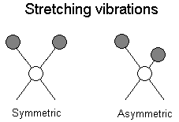
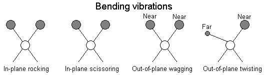

infrared radiation - lower energy than visible spectrum
- causes changes in vibrations of covalent bonds
- the bonds absorb specific wavelengths from the IR region triggering them to move up a vibrational energy level
- to absorb IR, there must be a change in the direction or strength of the charge separation as a result of the bending or stretching. For this reason molecules eg O2 do not absorb.
- absorption of higher frequency wavelengths is caused by more frequent vibrations
- more vibrations are caused by:
	- shorter, stronger bonds (shorter spring)
	- smaller molecules attached to the spring

(bonds stretch and contract)

(bonds swing back and forth)
https://teaching.shu.ac.uk/hwb/chemistry/tutorials/molspec/irspec1.htm
(do we need to know this?)

Infrared spectrums show the proportion of infrared radiation that is transmitted (opposite of absorbed)
- absorbance peaks - local minimums

x axis - wavenumber
- how many waves fit into 1 centimeter

IR spectroscopy can identify molecular compounds
- shows functional groups present