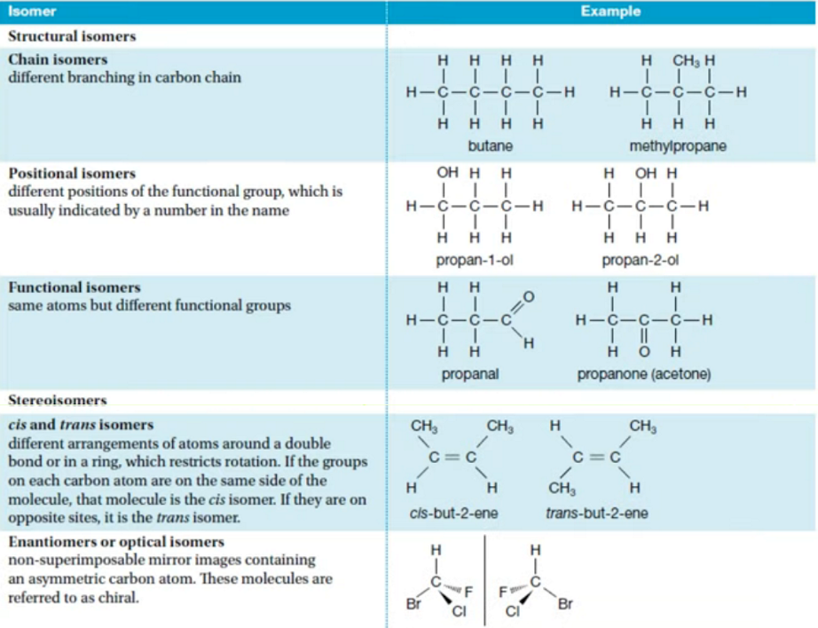
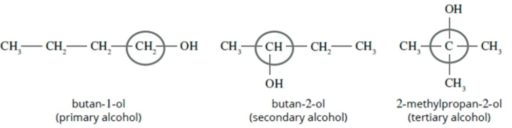

Functional isomers
	- Same molecular formula, different functional group

Eg:
	- Esters and carboxylic acids
	- Aldehydes and ketones
	- Alcohols and ethers
	- En-ol and ketones

Types of alcohols (positional isomer)
	- Primary, secondary, tertiary
	- Corresponding to the number of carbons the carbon attached to the OH is attached to
	- Reacivity v as go from primary to tertiary, because "c-c bonds are strong"
		○ Only primary can become -oic acid

Geometric is not on the course.
- But optical is

2 types of isomers.
- Structural isomers
	○ Compounds w/ same molecular formula bonded differently leadig to a different structural formular
		§ Eg chain isomers, positional isomers
- Stereoisomers
	○ Compounds w/ same molecular formula, structural formula but have a different arrangement in space (different spatial arrangement)
		§ Eg optical isomers

Enantiomer - a non-superimposable mirror image (embed phrase in every relevant question)
	○ "these 2 optical isomers are enantiomers of each other"

Optical isomers
- Different effect on plane polarised light
- Plane polarised light is light which consists of waves in which the direction of the vibration is the same for all waves.
One optical isomer will rotate the plane polarised light clockwise and one optical isomer will rotate it anticlockwise. A pair of optical isomers is called a pair of enantiomers
- rotate light in opposite directions, but same number of degrees

Chirality
	- Chiral carbon must have 4 different atoms or groups of atoms attached to it
	- Have no plane of symmetry
